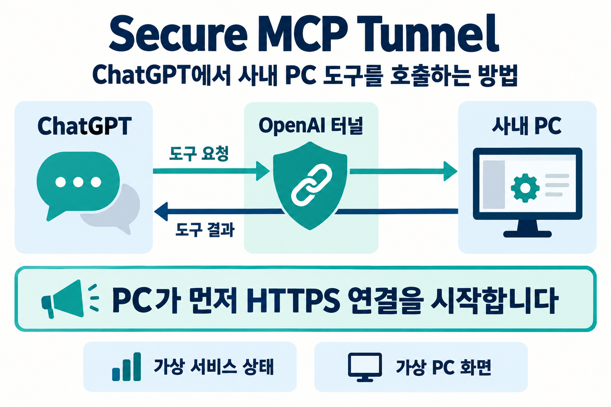

# Secure MCP Tunnel 웨비나 예제



**ChatGPT에서 사내 PC의 도구를 호출하는 흐름을 가상 데이터로 실습합니다.**

[로컬 실습](#api-키-없이-로컬에서-호출) · [ChatGPT 연결](#chatgpt에서-개인-시연-터널로-호출) · [자주 묻는 질문](#자주-묻는-질문)

## 어떤 예제인가요?

MCP는 ChatGPT가 도구의 이름, 입력 형식, 실행 결과를 주고받는 규약입니다. 이 예제의 MCP 서버는 PC에서 실행하는 Rust 프로그램입니다. Secure MCP Tunnel은 ChatGPT의 요청과 도구 결과를 전달합니다.

| 예제 | MCP 도구 | 시연 입력 | 예상 결과 |
| --- | --- | --- | --- |
| [가상 서비스 상태](examples/service_catalog.rs) | `get_demo_service_status` | `{"service":"demo_queue"}` | `demo_queue: degraded (synthetic backlog)` |
| [가상 PC 화면](examples/workstation_view.rs) | `get_demo_workspace_view` | `{}` | `Window: Demo Console`, `Status: Ready` |

서비스 조회는 정해진 가상 서비스 이름만 받습니다. 화면 조회는 코드에 정의한 가상 화면의 글자를 반환합니다.

### 호출이 오가는 순서

1. PC에서 실행 중인 `tunnel-client`가 OpenAI 터널 서비스에 HTTPS 연결을 시작합니다.
2. ChatGPT가 연결된 플러그인에서 도구를 호출하면 `tunnel-client`가 요청을 받습니다.
3. PC의 Rust 프로그램이 요청을 처리합니다. `tunnel-client`가 결과를 OpenAI에 전달합니다.

외부에서 PC로 들어오는 포트를 열 필요가 없습니다. 아래 로컬 실습은 같은 PC 안에서 터널을 모의 실행합니다.

## 빌드

Rust 1.88 이상과 [OpenAI tunnel-client](https://github.com/openai/tunnel-client/releases/latest)를 설치하라. GitHub에서 ZIP을 내려받거나 `git clone`으로 코드를 받아라. `Cargo.toml`이 있는 폴더에서 다음 명령을 실행하라.

```sh
cargo build --release --locked --examples
```

실행 파일은 `target/release/examples/`에 생성됩니다. Windows 실행 파일에는 `.exe`가 붙습니다.

## API 키 없이 로컬에서 호출

이 단계에서는 OpenAI API 키와 ChatGPT 플러그인 설정이 필요 없습니다. 첫 번째 터미널에서 모의 터널을 실행하라.

### Windows PowerShell 7

```powershell
$server = (Resolve-Path './target/release/examples/service_catalog.exe').Path.Replace('\', '/')
tunnel-client dev proxy --mcp-command ('"' + $server + '"') --duration 5m --print-json
```

### macOS와 Linux

```bash
tunnel-client dev proxy --mcp-command "\"$PWD/target/release/examples/service_catalog\"" --duration 5m --print-json
```

### 첫 도구 호출

기존에 쓰는 MCP 클라이언트가 있다면 그대로 사용하라. 처음이라면 공식 [MCP Inspector](https://modelcontextprotocol.io/docs/2026-07-28/tools/inspector)를 사용하라. Inspector를 실행할 때는 공식 문서에 나온 Node.js 버전을 설치하라.

두 번째 터미널에서 아래 명령을 실행하면 브라우저에서 Inspector가 열립니다.

```sh
npx @modelcontextprotocol/inspector
```

1. 첫 번째 터미널에서 출력의 `mcp_url` 값을 복사하라.
2. MCP 클라이언트에서 전송 방식으로 **Streamable HTTP**를 선택하라.
3. 복사한 주소로 연결하라.
4. 도구 목록에서 `get_demo_service_status`를 선택하라.
5. `service`에 `demo_queue`를 넣고 실행하라.

예상 결과는 `demo_queue: degraded (synthetic backlog)`입니다. 실습용 작업 큐가 밀린 상황을 표현합니다.

가상 PC 화면을 보려면 첫 터미널에서 Ctrl+C를 눌러라. 같은 명령에서 실행 파일 이름을 `workstation_view`로 바꿔라. 새 `mcp_url`로 연결한 뒤 `get_demo_workspace_view`를 실행하라. 입력은 빈 객체 `{}`입니다. 결과에 `Window: Demo Console`과 `Status: Ready`가 표시됩니다.

## ChatGPT에서 개인 시연 터널로 호출

1. [Platform 터널 설정](https://platform.openai.com/settings/organization/tunnels)에서 시연 터널을 만들어라.
2. 터널을 시연에 사용할 ChatGPT 워크스페이스에 연결하라.
3. Tunnels **Read + Use** 권한이 있는 런타임 키를 준비하라. 이 키는 PC의 `tunnel-client`가 터널에 연결할 때 사용합니다.
4. 아래 명령으로 프로필을 만들고 `tunnel-client`를 실행하라.

PowerShell 7에서는 키를 마스킹해 입력합니다. 프로필은 키 값 대신 환경 변수 이름을 참조합니다.

```powershell
$tunnelId = Read-Host 'Demo tunnel ID'
$env:CONTROL_PLANE_API_KEY = Read-Host 'Tunnel runtime API key' -MaskInput
$server = (Resolve-Path './target/release/examples/service_catalog.exe').Path.Replace('\', '/')
tunnel-client init --sample sample_mcp_stdio_local --profile webinar-services --tunnel-id $tunnelId --mcp-command ('"' + $server + '"')
tunnel-client doctor --profile webinar-services --explain
tunnel-client run --profile webinar-services --mcp.stdio-send-initialized-notification
```

Bash에서는 다음 명령을 실행하라.

```bash
read -r -p 'Demo tunnel ID: ' TUNNEL_ID
read -r -s -p 'Tunnel runtime API key: ' CONTROL_PLANE_API_KEY
printf '\n'
export CONTROL_PLANE_API_KEY
tunnel-client init --sample sample_mcp_stdio_local --profile webinar-services --tunnel-id "$TUNNEL_ID" --mcp-command "\"$PWD/target/release/examples/service_catalog\""
tunnel-client doctor --profile webinar-services --explain
tunnel-client run --profile webinar-services --mcp.stdio-send-initialized-notification
```

[ChatGPT Plugins](https://chatgpt.com/plugins)에서 사용자 지정 MCP 서버를 추가하라. 연결 방식은 **Tunnel**을 선택하라. 위에서 사용한 터널을 연결하라. 아래 문장으로 도구가 실제로 응답하는지 확인하라.

> get_demo_service_status 도구로 demo_queue의 상태를 조회해 줘.

PC 화면 예제에는 별도 시연 터널을 써라. 프로필 이름을 `webinar-workstation`으로 바꿔라. 실행 파일을 `workstation_view`로 바꿔라. 두 프로필을 동시에 실행하려면 두 번째 프로필의 init 명령에 `--health-listen-addr 127.0.0.1:8081`을 추가하라.

> get_demo_workspace_view 도구를 호출해서 가상 화면의 창 이름과 상태를 알려 줘.

시연을 마치면 Ctrl+C로 `tunnel-client`를 종료하라. 런타임 키를 입력한 터미널을 닫아라.

## 자주 묻는 질문

### 로컬 실습과 ChatGPT 연결은 어떻게 다른가요?

로컬 실습은 PC 안에서만 모의 터널과 Rust 예제를 실행합니다. ChatGPT 연결은 OpenAI에 만든 터널과 연결된 워크스페이스를 사용합니다. 먼저 로컬에서 예상 결과를 확인하라.

### 회사 방화벽에 인바운드 포트를 열어야 하나요?

PC 안의 `tunnel-client`가 외부로 HTTPS 연결을 시작합니다. PC에 외부 접속을 받는 포트를 열 필요가 없습니다. 아웃바운드 연결이 제한된 회사에서는 네트워크 관리자에게 OpenAI 터널 서비스 연결을 확인하라.

### 이 예제가 실제 사내망이나 PC 화면을 읽나요?

두 예제가 가상 데이터만 반환합니다. 서비스 예제는 `demo_api`와 `demo_queue`를 받습니다. 화면 예제는 Rust 코드에 정의한 글자 네 줄을 반환합니다.

### 터널이 연결되면 ChatGPT가 PC 어디에나 접근할 수 있나요?

ChatGPT의 도구 호출은 플러그인이 등록한 MCP 서버로 전달됩니다. 도구가 어떤 파일이나 서비스에 접근할지는 서버 코드와 그 프로그램의 실행 권한이 정합니다. 실제 업무에 적용할 때는 필요한 도구와 데이터만 연결하라.

### 연결은 됐는데 도구 목록이 비어 있으면 어떻게 하나요?

로컬 실습에서는 모의 터널을 실행한 터미널이 켜져 있는지 확인하라. 클라이언트에 현재 실행의 `mcp_url`을 입력했는지 확인하라. ChatGPT에서는 선택한 터널과 워크스페이스 연결을 확인하라. `tunnel-client doctor --profile webinar-services --explain`으로 서비스 예제의 프로필을 검사하라.

### ChatGPT에서 터널이 목록에 안 보이면 어떻게 하나요?

Platform에서 터널에 연결한 ChatGPT 워크스페이스를 확인하라. 워크스페이스 관리자에게 사용자 지정 MCP 서버 권한을 확인하라. 터널을 만드는 데는 **Read + Manage** 권한이 필요합니다. 앱에서 터널을 선택하거나 `tunnel-client`로 연결하는 데는 **Read + Use** 권한이 필요합니다.

### 두 예제를 함께 시연할 수 있나요?

두 로컬 실습은 출력하는 `mcp_url`이 각각 다릅니다. 각 주소를 별도 연결에 입력하라. ChatGPT에 연결할 때는 예제별로 터널, 프로필, 로컬 상태 점검 포트를 지정하라.

### 결과는 어디로 전달되나요?

ChatGPT 연결에서는 도구가 반환한 결과가 터널을 거쳐 OpenAI로 전달됩니다. 공개 데모에서는 가상 데이터만 사용하라. 런타임 키를 README, 셸 명령 이력, 화면 공유에 넣지 마라.

### GitHub에 코드를 공개하면 플러그인도 공개되나요?

GitHub에서 누구나 이 예제 코드를 읽을 수 있습니다. ChatGPT에서 시연 터널을 사용하려면 연결한 워크스페이스와 권한이 필요합니다. 공개 플러그인을 배포할 때는 OpenAI의 공개 HTTPS MCP 엔드포인트 요건을 따르라.

[OpenAI Secure MCP Tunnel 공식 문서](https://developers.openai.com/api/docs/guides/secure-mcp-tunnels)
